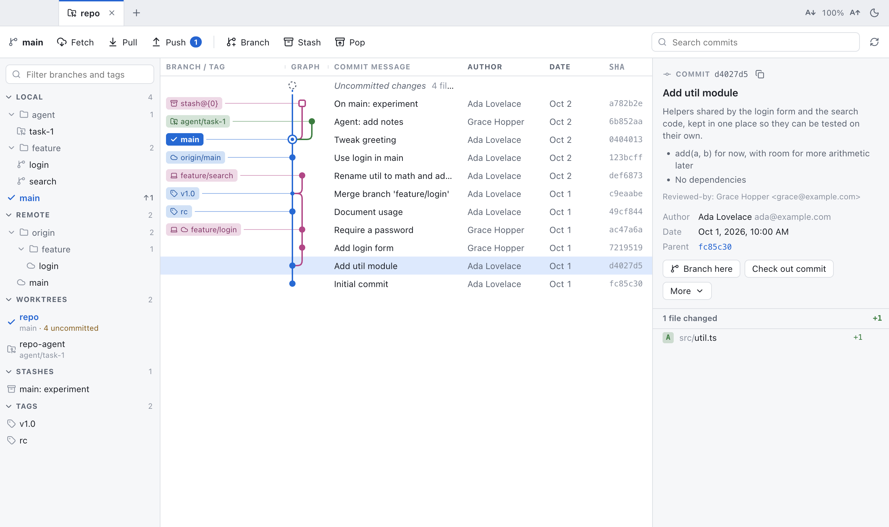
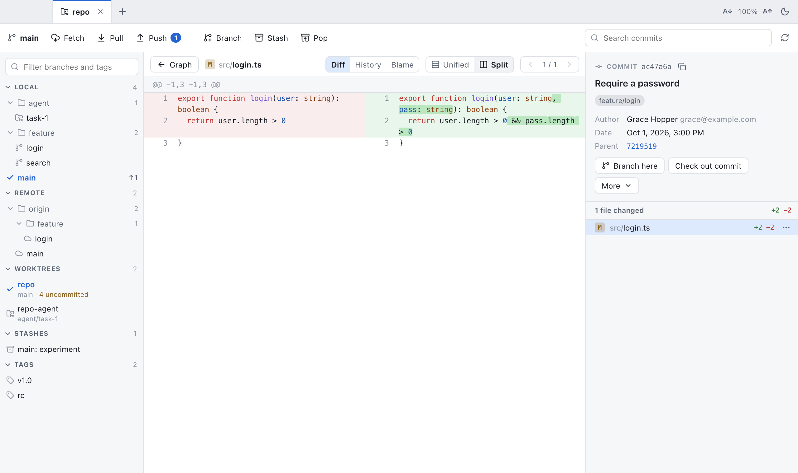
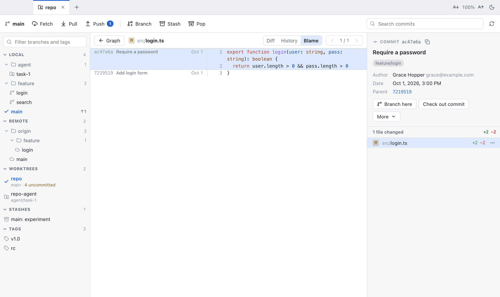
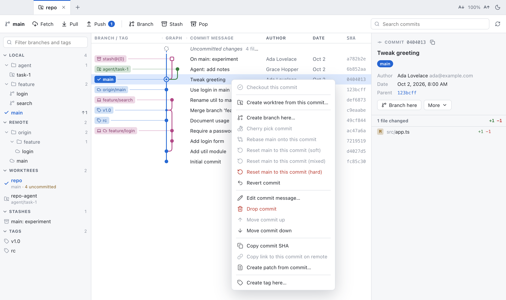

# Branchline

A local git graph viewer and history tool: no account, no subscription, no telemetry.

**[Website and downloads](https://chuckconway.github.io/branchline/)**

<picture><source media="(prefers-color-scheme: dark)" srcset="docs/images/graph-dark.png"></picture>

## Install

Branchline runs the `git` already on your machine, and needs git 2.31 or newer. If git is
missing or too old, the app says so at the top of the window.

- **macOS:** download the `.dmg` for Apple Silicon (`arm64`) or Intel (`x64`) from the
  [Releases page](https://github.com/chuckconway/branchline/releases/latest), open it, and drag
  Branchline to Applications.
- **Linux:** download the `.AppImage` from the
  [Releases page](https://github.com/chuckconway/branchline/releases/latest), then `chmod +x` it
  and run it.
  It needs GTK 3, which desktop distributions already have.
- **Windows:** not supported yet; builds are experimental.

To build it yourself, see [CONTRIBUTING.md](CONTRIBUTING.md).

## What it does

- Commit graph with lanes, branch and tag labels, stashes, and a row for uncommitted changes.
- Sidebar of local branches, remotes, worktrees, stashes and tags, with a filter.
- Commit details and per-file diffs, unified or side by side, with syntax colouring.

  <picture><source media="(prefers-color-scheme: dark)" srcset="docs/images/diff-dark.png"></picture>

- File history (following renames) and blame for any changed file.

  <picture><source media="(prefers-color-scheme: dark)" srcset="docs/images/blame-dark.png"></picture>

- Stage, unstage and commit; fetch, pull (fast-forward only), push or publish; check out a
  branch or commit; create a branch; stash and pop.
- Right-click a commit (or use the More button) to cherry-pick, revert, rebase onto it, reset
  to it, edit its message, drop it, move it, create a worktree from it, copy its SHA or its
  link on the remote, save it as a patch, or tag it (optionally annotated, optionally pushed).

  <picture><source media="(prefers-color-scheme: dark)" srcset="docs/images/menu-dark.png"></picture>

- Right-click a branch, in the sidebar or on its label in the graph, to check it out, copy
  its name, or delete it locally, on the remote, or both.
- One tab per repository. A linked worktree opens as its own tab.
- Text size: the controls at the right of the tab bar zoom the whole window from 80% to 200%,
  and the level is remembered. Columns and button labels give way as space runs out.
- Worktrees show how many uncommitted changes each holds. Right-click one to open it, show it
  in the file manager, copy its path, or remove it (with its branch, if you ask). Worktrees
  whose folder has gone are flagged, and one click prunes them.

Everything has a button or a menu entry; nothing needs a keyboard shortcut.

## What it will and will not do to your repository

Two rules shape the operations that change history:

- **All or nothing.** There is no conflict-resolution screen. A cherry-pick, revert, rebase,
  drop or move that cannot apply cleanly is aborted, and the repository is left exactly as it
  was. An operation that something else started is never aborted on its behalf.
- **Ask before losing anything.** Reset, drop, rebase and delete confirm first. A hard reset
  says how many uncommitted files it will discard, editing a commit that is already pushed
  warns that the branch will need a force-push (which this app does not do), and deleting a
  branch says how many commits exist on no other branch or tag.

Deleting a branch never follows its upstream: "also delete on the remote" means the remote
branch of the same name, so a branch cut from `dev` cannot take `origin/dev` with it. The
checked-out branch, a branch held by another worktree, and a remote's default branch cannot
be deleted from here.

A worktree is only ever removed when it is clean; there is no force option. A worktree whose
folder is gone still holds its branch until it is pruned, which is why pruning is what makes
those branches deletable.

Branchline never does these:

- discard changes to a file,
- force-push,
- delete a tag.

The only network calls are your own `git fetch`, `pull` and `push`.

## Built for watching agents work

Branchline is for looking at a repository that something else (you, or a coding agent) is
changing.

- The view refreshes on its own when commits, branches, stashes or working files change.
- Reading never takes git's index lock, so it cannot get in the way of a commit that is
  happening in the same repository.
- Each worktree shows how many uncommitted changes it holds, so you can see which agents have
  work in progress.

## Open from a terminal

```sh
open -a Branchline /path/to/repo                  # macOS
./Branchline-*.AppImage /path/to/repo             # Linux: a folder as the first argument
```

Opening also works from the Open button, and by dropping a folder on the window or, on macOS,
on the Dock icon.

## Develop

Setup, the test commands and the rules for changes are in [CONTRIBUTING.md](CONTRIBUTING.md).

## Layout

```
src/shared/    types, graph lane layout, diff and git-output parsers (pure)
src/main/      git execution, repository queries and actions, file watcher, window
src/preload/   the typed bridge exposed to the UI as window.api
src/renderer/  React UI
tests/         unit tests, fixture-repository builder, end-to-end smoke test
```

The design notes are in `docs/design.md`.

## License

MIT. See [LICENSE](LICENSE).
